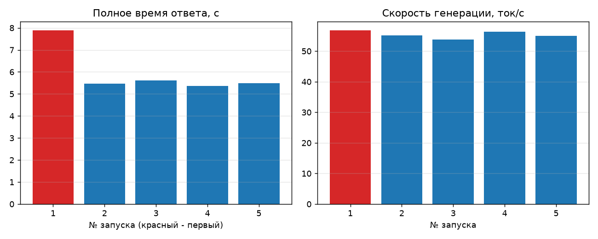
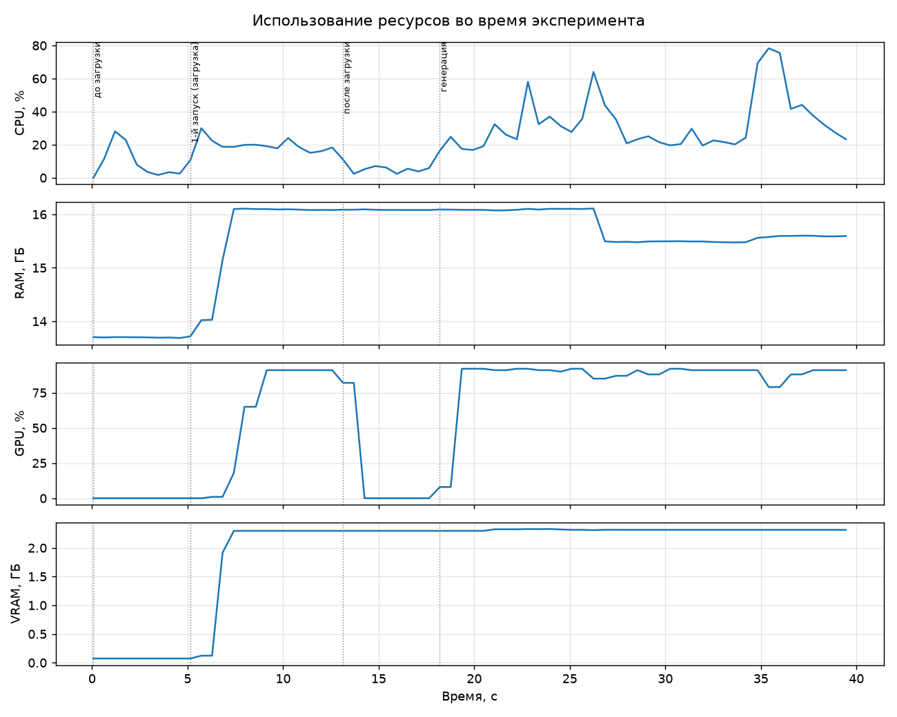

# Лабораторная работа №5

## Тема
Развёртывание и исследование локальной большой языковой модели.

## Цель
Развернуть LLM на своём компьютере, подключить к ней Python-клиент через HTTP API, измерить скорость и
потребление ресурсов, а затем на измерениях (а не на впечатлении) решить, для каких задач такая модель
годится, а для каких нет.

## Задачи
1. Выбрать и загрузить компактную инструкционную модель, зафиксировать её параметры.
2. Провести диалог из пяти типов запросов и оценить корректность ответов.
3. Реализовать Python-клиент к локальному API.
4. Замерить время ответа и скорость генерации (первый запуск отдельно от повторных).
5. Измерить CPU, RAM, GPU и VRAM до загрузки, после загрузки и во время генерации.
6. Исследовать влияние температуры.
7. Сравнить две конфигурации (аналитически, см. ниже).
8. Реализовать индивидуальное задание: локальный анализатор журналов событий.

## Используемые технологии
- LM Studio (локальный сервер, нативный REST API `/api/v0` и OpenAI-совместимый `/v1`)
- Модель: **Qwen2.5-3B-Instruct**, GGUF, квантование **Q4_K_M**, локальная (облако не используется)
- Движок: llama.cpp (win-x86_64-nvidia-cuda12-avx2, версия 2.50.0)
- Параметры запуска: контекст 8192 токенов, температура 0,2 (если не указано иное)
- Python 3.14, `requests`, `psutil`, `matplotlib`; PyCharm; Git

**Компьютер:** Windows 11, Intel Core i5-10300H (4 ядра / 8 потоков), 31,8 ГБ RAM, NVIDIA GeForce GTX 1650 Ti (4 ГБ VRAM).

## Структура проекта
```text
lab05/
├── README.md
├── requirements.txt
├── .env.example          # шаблон конфигурации (реальных ключей нет)
├── src/                  # код: run_all.py, client.py, monitor.py, benchmark.py, dialog.py, ...
├── data/                 # синтетический журнал и эталон для индивидуального задания
├── results/              # результаты запуска (CSV, JSON, MD, графики)
├── screenshots/          # скриншоты LM Studio и мониторинга
└── report/               # итоговый отчёт
```

## Описание решения

### Выбор модели и конфигурации
В 4 ГБ видеопамяти должны поместиться веса, кэш контекста и запас под систему. Для модели 3B в FP16 одни
только веса заняли бы около 6 ГБ (3·10⁹ × 2 байта) и не поместились бы. Квантование Q4_K_M сокращает
файл до 2,1 ГБ, и по измерению модель занимает около 2,3 ГБ VRAM, то есть остаётся запас. LM Studio
выбрана как среда с готовым локальным API, допустимая методичкой наравне с Ollama.

### Клиент
`src/client.py` обращается к `/api/v0/chat/completions`, потому что этот эндпоинт возвращает статистику
генерации (токены/с, время до первого токена). Если его нет, клиент переключается на `/v1` и считает
скорость по общему времени (поле `stats_source`). В этом запуске везде источник — LM Studio.

### Измерения
- Перед замером модель выгружается, поэтому первый запрос включает загрузку (холодный старт; программа
  проверяет состояние `not-loaded`).
- Ресурсы снимаются фоновым потоком каждые 0,5 с с пометкой фазы: CPU и RAM через `psutil`, GPU и VRAM
  через `nvidia-smi`.
- Температура: три значения × три повтора, повторяемость как среднее попарное сходство Жаккара по словам.

### Безопасность
API слушает только `127.0.0.1` (программа проверяет адрес). В репозитории нет ключей и весов, `.env` в
`.gitignore`, тестовые данные синтетические, код, сгенерированный моделью, программой не исполняется.
Интернет нужен только для загрузки модели и движка; полное отключение сети на время замеров не проводилось.

## Запуск
```bash
pip install -r requirements.txt
```
1. В LM Studio загрузите модель, во вкладке Developer включите загрузку по запросу (JIT), нажмите Start Server.
2. Скопируйте `.env.example` в `.env` и при необходимости поправьте `MODEL_NAME`.
3. Запустите: `python src/run_all.py` (по запросу выгрузите модель в LM Studio и нажмите Enter).

Результаты сохраняются в `results/`, сводка — `results/report_data.md`. Отдельные части:
`python src/client.py "вопрос"`, `python src/log_analyzer.py [файл]`.

## Эксперименты и результаты

### Эксперимент 1. Время и скорость (задание 4)
Запрос «Объясни принцип наименьших привилегий в ИБ.», 5 запусков, температура 0,2, лимит 300 токенов.

| № | Запуск | Время, с | До 1-го токена, с | Токенов | Ток/с |
|---|---|---:|---:|---:|---:|
| 1 | первый (с загрузкой) | 7,895 | 0,282 | 300 | 56,84 |
| 2 | повторный | 5,464 | 0,020 | 300 | 55,18 |
| 3 | повторный | 5,610 | 0,020 | 300 | 53,79 |
| 4 | повторный | 5,365 | 0,019 | 300 | 56,27 |
| 5 | повторный | 5,498 | 0,020 | 300 | 55,01 |

Среднее время повторных запусков 5,48 с (σ = 0,10), скорость 55,06 ток/с, первый запуск медленнее в 1,44 раза.
Скорость генерации в первом запуске не хуже, поэтому лишние ~2,3 с (оценка: полное время минус время до
первого токена минус время генерации) приходятся на загрузку весов и инициализацию CUDA. Во всех запусках
достигнут лимит 300 токенов (ответы обрезаны), для сравнения времени это не мешает.



### Эксперимент 2. Ресурсы (задание 5)

| Показатель | До загрузки | После загрузки | Во время генерации |
|---|---:|---:|---:|
| RAM, ГБ | 13,70 | 16,08 | 15,75 (макс. 16,11) |
| CPU, % | 9,06 | 5,51 | 32,61 (макс. 78,3) |
| VRAM, ГБ | 0,07 | 2,30 | 2,31 (макс. 2,33) |
| GPU, % | 0,0 | 18,22 | 85,37 (макс. 92,0) |



- Модель живёт в VRAM (+2,2 ГБ). Расчётная оценка KV-кэша для 8192 токенов — около 0,28 ГБ (36 КБ/токен
  по параметрам архитектуры; оценка, не измерение); при 32768 токенов было бы около 1,1 ГБ.
- Скорость ограничена GPU (85% загрузки).
- RAM измерялась по всей системе (в 13,7 ГБ входят другие программы), выделить вклад LM Studio нельзя.
- 18% GPU в фазе «после загрузки», вероятно, хвост генерации и усреднение nvidia-smi (предположение).

### Эксперимент 3. Пять тестовых запросов (задание 2)
Полные ответы: [`results/examples.md`](./results/examples.md).

| № | Тип | Время, с | Ручная оценка |
|---|---|---:|---|
| 1 | Фактологический | 5,05 | Частично: суть верна, но 6 предложений вместо 5, английские вставки |
| 2 | Суммаризация | 4,61 | Верно, три пункта |
| 3 | Классификация | 2,30 | Верно («инцидент»), объяснение общее |
| 4 | JSON | 2,29 | Частично: обёрнут в ```json, риск `medium` занижен |
| 5 | Код Python | 7,30 | Частично: проверяет, **является** ли строка адресом, а не **содержит** его; принимает `1_0.0.0.1`, `+1.2.3.4` |

Автопроверки в программе формальные: по запросам 1 и 2 они дали ложное «не пройдено» (регулярка
посчитала номера пунктов и вложенный список), поэтому оценка ручная.

### Эксперимент 4. Температура (задание 6)
Запрос: название и описание из трёх предложений для вымышленного стартапа по ИБ; 3 повтора на значение.

| Температура | Сходство / разнообразие | Результат | Ошибки |
|---|---|---|---|
| 0,0 | 0,83 / 0,17 | Одно название «SecureSphere», 2 из 3 ответов совпали дословно | 4 предложения вместо 3; идентичности нет (вероятно, недетерминизм GPU) |
| 0,8 | 0,16 / 0,84 | Три разных названия, вместо одного варианта несколько | Ответы обрезаны лимитом; несовпадение названия и описания |
| 1,5 | 0,12 / 0,88 | Максимум разнообразия | Переключение на китайский язык, бессмыслица |

Подробно: [`results/temperature.md`](./results/temperature.md).

### Эксперимент 5. Сравнение двух моделей (задание 7)
Вторая модель не запускалась: Qwen2.5-7B Q4_K_M (около 4,7 ГБ) не помещается в 4 ГБ VRAM целиком. Анализ:
модель A измерена; для B (7B) ожидаются частичная выгрузка на CPU, заметное замедление и более высокое
качество — это оценка, не измерение. Подробности в отчёте.

### Индивидуальное задание: анализ журнала событий
`src/log_analyzer.py` передаёт журнал локальной модели и получает JSON-находки (JSON Schema на стороне
сервера, ошибок разбора 0). Тест: синтетический журнал из 27 строк, 4 заложенных события.
Результат: [`results/log_analysis.md`](./results/log_analysis.md), время 20,3 с.

| Событие в журнале | Результат модели |
|---|---|
| Перебор root с 203.0.113.45 и успешный вход | Найден перебор, но успешный вход (компрометация) не отмечен |
| Сканирование портов 198.51.100.7 | Найдено, но описано как попытки доступа к SSH/FTP |
| www-data читает /etc/shadow | Найдено, загрузка скрипта wget не упомянута |
| Создан пользователь support_tmp с sudo | **Пропущено** |
| Штатные действия ivanov | **Ложное срабатывание** (выдумано «несколько неудачных входов») |

Полнота по ключевым словам 3 из 4, 1 ложное срабатывание. Ответ на английском, у всех находок одна
категория и severity `high`, приоритизации нет. Локальное размещение оправдано: журналы содержат внутренние
IP, имена пользователей и хостов и не уходят во внешний сервис.

## Вывод
Qwen2.5-3B Q4_K_M успешно запущена локально: целиком в VRAM (2,3 ГБ из 4), около 55 токенов/с, 5,5 с на
ответ из 300 токенов, холодный старт добавляет около 2,3 с. Скорость ограничена видеокартой.

Модель подходит для быстрого локального пересказа, общих объяснений и черновой сортировки журналов под
контролем человека, особенно если данные нельзя отправлять наружу. Её недостаточно для автономных решений
в ИБ: она нарушает точные ограничения формата, написала код под другую постановку, занизила риск в JSON,
пропустила создание привилегированной учётной записи в журнале и выдумала факт про штатного пользователя.
Температура 1,5 разрушает ответы, для практических задач нужны 0–0,2.

**Ограничения:** одиночные прогоны; RAM и CPU системные; настройки GPU offload и версия LM Studio не
фиксировались автоматически; один небольшой синтетический журнал; ручная оценка одним человеком; задание 7
аналитическое.

**Что улучшить:** автотесты для сгенерированного кода, русскоязычные инструкции и примеры в промпте
анализатора, повторные прогоны, сравнение с моделью 7B на видеокарте с большей памятью.

Полный отчёт: [`report/`](./report/).
