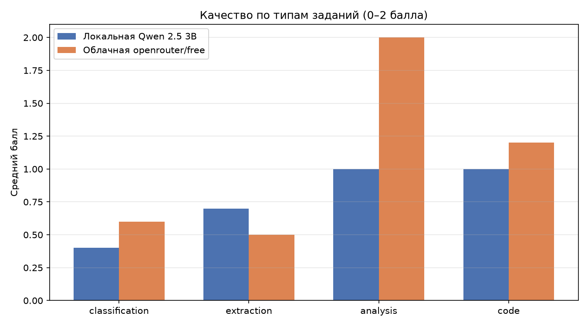
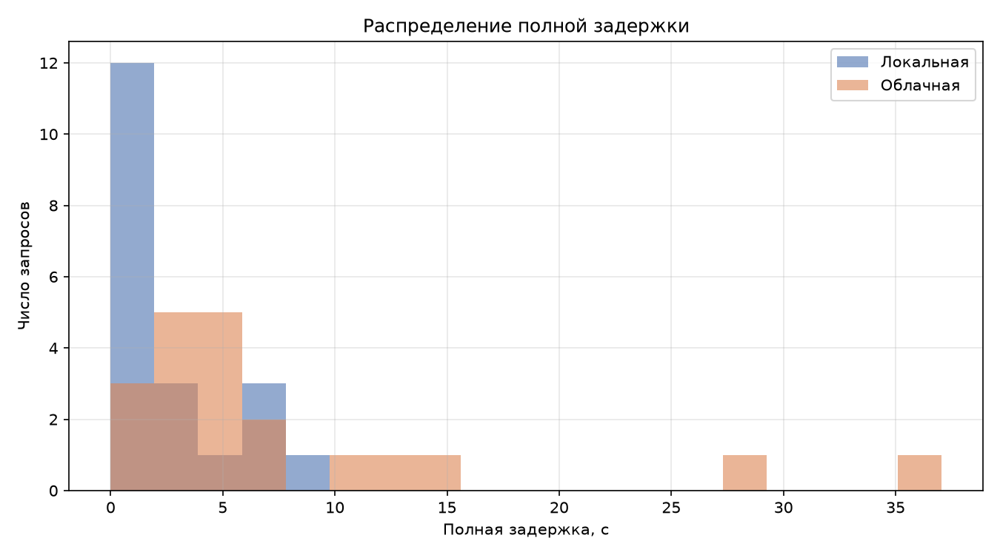
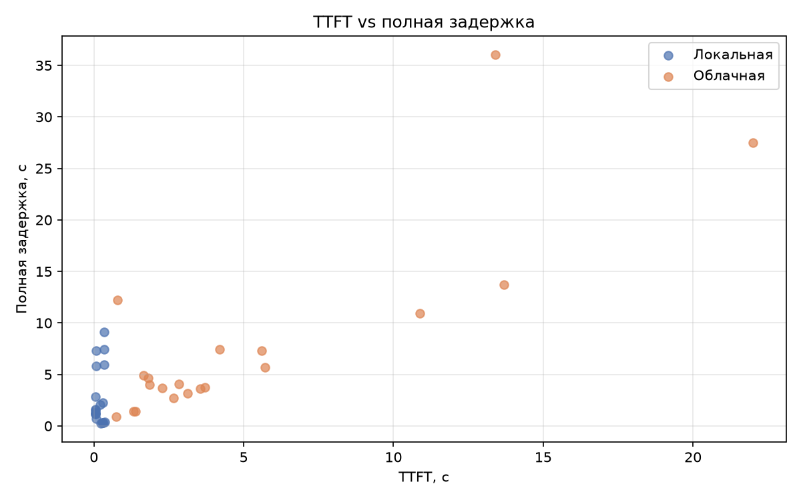

# Лабораторная работа №6

## Тема
Сравнение локальных и облачных больших языковых моделей: качество, производительность, стоимость и безопасность.

## Цель работы
Научиться обоснованно выбирать архитектуру применения большой языковой модели, сопоставляя качество ответа, задержку, пропускную способность, стоимость, требования к вычислительным ресурсам, приватность данных и эксплуатационные риски.

## Задачи
1. Подготовить воспроизводимый тестовый набор из 20 заданий четырёх типов.
2. Реализовать единый программный стенд для локальной и облачной моделей.
3. Измерить время первого токена (TTFT), полное время ответа и скорость генерации.
4. Оценить качество ответов по заранее заданным критериям.
5. Рассчитать ориентировочную стоимость облачного выполнения.
6. Провести анализ информационной безопасности и составить матрицу допустимых данных.
7. Сформулировать аргументированный вывод для конкретного прикладного сценария.

## Используемые технологии

- **Python 3.14**
- **LM Studio 0.4.23** — локальный сервер с OpenAI-совместимым API
- **OpenRouter** — облачный доступ к LLM через единый API
- Библиотеки: `openai`, `python-dotenv`, `pandas`, `matplotlib`, `psutil`
- **Git** — контроль версий

### Модели

**Локальная модель:**
- Название: `Qwen2.5-3B-Instruct`
- Формат: GGUF, квантование Q4_K_M
- Размер: 2.1 ГБ
- Способ запуска: LM Studio, локальный сервер `http://localhost:1234/v1`
- Архитектура: qwen2, 3B параметров
- Контекст: 8192 токенов

**Облачная модель:**
- Название: `openrouter/free` (роутер бесплатных моделей)
- Поставщик: OpenRouter
- Тариф: бесплатный (лимиты 20 RPM / 50 RPD)
- Особенность: пул разных бесплатных моделей, а не одна фиксированная модель

**Параметры генерации:**
- temperature = 0.2
- max_tokens = 500
- system prompt: «Отвечай точно и структурированно.»

### Аппаратная конфигурация

| Параметр | Значение |
|---|---|
| ОС | Windows 11 |
| Процессор | Intel Core i5-10300H, 2.5 ГГц |
| Ядер / потоков | 4 / 8 |
| ОЗУ | 32 ГБ |
| GPU | NVIDIA GeForce GTX 1650 Ti |
| VRAM | 4 ГБ |
| Python | 3.14 |

## Структура проекта

```
lab06/
├── README.md
├── requirements.txt
├── .env.example
├── .gitignore
├── src/
│   ├── providers.py
│   ├── benchmark.py
│   ├── aggregate.py
│   ├── plots.py
│   └── test_free_models.py
├── data/
│   ├── test_cases.json
│   └── scores.csv
└── results/
    ├── raw_results_openrouter_free.csv
    ├── summary.csv
    ├── summary_performance.csv
    ├── summary_quality.csv
    ├── summary_quality_by_type.csv
    ├── plot_quality_by_type.png
    ├── plot_latency_distribution.png
    └── plot_ttft_vs_latency.png
```

## Описание решения

### Выбор локальной модели
Локальная модель `Qwen2.5-3B-Instruct Q4_K_M` — продолжение лабораторной работы №5. Она уже развёрнута в LM Studio и полностью помещается в 4 ГБ видеопамяти (фактически занимает ~2.3 ГБ VRAM). Квантование Q4_K_M выбрано как компромисс между размером и качеством: без него модель в FP16 заняла бы около 6 ГБ и не поместилась бы в GPU.

### Выбор облачной модели
В качестве облачной модели использован **роутер `openrouter/free`**. Это не одна модель, а официальный маршрутизатор OpenRouter, который автоматически выбирает случайную доступную бесплатную модель под каждый запрос.

Такое решение принято по практической причине: каталог бесплатных моделей OpenRouter динамически меняется. В ходе подготовки к ЛР6 фиксированные модели, изначально выбранные для эксперимента, перестали отдавать ответы:
- `google/gemma-4-26b-a4b-it:free` — постоянные ошибки 429 (upstream shared pool rate limit);
- `qwen/qwen3-4b:free` — 404 «No endpoints found»;
- `meta-llama/llama-3.3-70b-instruct:free`, `mistralai/mistral-small-3.1-24b-instruct:free`, `deepseek/deepseek-r1:free` — 404 «unavailable for free».

Роутер обеспечил стабильный доступ к бесплатному инференсу. **Ограничение:** под именем `openrouter/free` скрываются разные модели, поэтому сравнение идёт не «модель против модели», а «локальная модель против пула бесплатных облачных моделей».

### Измерения
- Единый клиент на базе `openai.OpenAI` с разными `base_url` для локального и облачного серверов.
- Для корректного измерения TTFT использован потоковый режим (`stream=True`).
- Между запросами пауза 2 секунды, чтобы не исчерпать дневной лимит бесплатного тарифа.
- При ошибке 429 или пустом ответе — до 5 повторов с экспоненциальной задержкой (5, 10, 20, 40 секунд).
- Если ответ облачной модели приходит в виде reasoning dump или ответа фильтра «User Safety: safe» — он сохраняется как есть, без ручного редактирования, и оценивается по общей рубрике.

### Тестовый набор
20 заданий четырёх типов:

| № | Тип | Критерий оценки |
|---|---|---|
| T01–T05 | Классификация события ИБ | Точное совпадение с эталонной меткой (0/1) |
| T06–T10 | Извлечение полей в JSON | Полнота и корректность полей (0 / 0.5 / 1) |
| T11–T15 | Краткий анализ риска | Рубрика 0–2 балла |
| T16–T20 | Работа с кодом и логикой | Рубрика 0–2 балла |

Все задания используют синтетические данные и IP-адреса из документационных диапазонов (RFC 5737: 192.0.2.0/24, 198.51.100.0/24, 203.0.113.0/24).

## Запуск

### Требования
- Python 3.10 или новее
- LM Studio с загруженной моделью Qwen2.5-3B-Instruct Q4_K_M
- Ключ OpenRouter (хранится в `.env`, не коммитится)

### Установка

```bash
cd lab06
python -m venv .venv

# Windows:
.venv\Scripts\activate
# Linux/macOS:
source .venv/bin/activate

pip install -r requirements.txt

copy .env.example .env    # Windows
cp .env.example .env      # Linux/macOS
```

### Переменные окружения

Файл `.env` (не коммитится):
```
OPENROUTER_API_KEY=sk-or-v1-...
LOCAL_BASE_URL=http://localhost:1234/v1
LOCAL_API_KEY=lm-studio
```

Файл `.env.example` (коммитится, без реальных значений):
```
OPENROUTER_API_KEY=your_openrouter_key_here
LOCAL_BASE_URL=http://localhost:1234/v1
LOCAL_API_KEY=lm-studio
```

### Порядок запуска

```bash
# 1. Убедиться, что LM Studio запущен и модель загружена
# Проверить: http://localhost:1234/v1/models должен возвращать JSON

# 2. Проверить доступность бесплатных моделей OpenRouter
python src/test_free_models.py

# 3. Прогон основного бенчмарка
python src/benchmark.py

# 4. Ручная оценка ответов (заполнить data/scores.csv)

# 5. Агрегация результатов
python src/aggregate.py

# 6. Построение графиков
python src/plots.py
```

## Результаты

### Производительность

| Метрика | Локальная Qwen 2.5 3B | Облачная `openrouter/free` | Комментарий |
|---|---:|---:|---|
| Средняя полная задержка, с | 2.66 | 7.97 | Локальная быстрее в 3 раза |
| Медианная задержка, с | 1.47 | 4.38 | Локальная стабильнее |
| Средний TTFT, с | 0.18 | 5.16 | Локальная быстрее в 29 раз |
| Средняя скорость генерации, ток/с | 41.41 | 11.23 | Локальная быстрее в 3.7 раза |
| Всего выходных токенов | 2823 | 1329 | Облако тратит меньше токенов |
| Ошибок API | 0 | 0 | Обе модели отработали без 429/500 |

### Качество

| Метрика | Локальная | Облачная |
|---|---:|---:|
| Сумма баллов | 15.5 / 40 | 21.5 / 40 |
| Процент от максимума | 38.8% | 53.8% |

### Качество по типам заданий

| Тип задания | Локальная | Облачная | Победитель |
|---|---:|---:|---|
| classification | 0.4 | 0.6 | Облако |
| extraction | 0.7 | 0.5 | Локальная |
| analysis | 1.0 | 2.0 | Облако |
| code | 1.0 | 1.2 | Облако |

### Сводная таблица

Полная сводка сохранена в `results/summary.csv`:

| Показатель | Локальная | Облачная | Комментарий |
|---|---:|---:|---|
| Средняя оценка качества | 0.775 | 1.075 | Облако лучше в 1.4 раза |
| Доля корректных ответов, % | 38.8 | 53.8 | Облако лучше на 15 п.п. |
| Средняя полная задержка, с | 2.66 | 7.97 | Локальная в 3 раза быстрее |
| Медианная задержка, с | 1.47 | 4.38 | Локальная стабильнее |
| TTFT, с | 0.18 | 5.16 | Локальная в 29 раз быстрее |
| Скорость генерации, ток/с | 41.41 | 11.23 | Локальная в 3.7 раза быстрее |
| RAM/VRAM (пик) | ~15.75 ГБ / 2.31 ГБ | — | Из ЛР5 |
| Стоимость 1000 запросов | условно $0 | $0 (free) | Обе бесплатны |
| Работа без сети | Да | Нет | |
| Риск передачи данных | Низкий | Высокий | |

### Графики







## Расчёт стоимости

Фактическая стоимость = **$0**, так как использован бесплатный роутер `openrouter/free`.

Гипотетический расчёт для платной модели того же класса (например, Qwen 2.5 3B с тарифом $0.05 за 1M входных и $0.10 за 1M выходных токенов):

```
C = Nвх × Pвх + Nвых × Pвых
```

Для одного запроса со средними 100 входными и 200 выходными токенами:

```
C = (100 / 1_000_000) × $0.05 + (200 / 1_000_000) × $0.10
  = $0.000005 + $0.00002
  = $0.000025
```

- Весь тестовый набор (20 запросов): ≈ **$0.0005**
- 1 000 запросов: ≈ **$0.025**
- 100 000 запросов: ≈ **$2.5**
- 1 000 000 запросов: ≈ **$25**

**Вывод по стоимости:** при малых объёмах облачный API дешевле локального (не нужно покупать GPU и платить за электричество). Но при росте нагрузки стоимость линейно растёт, тогда как локальная модель имеет фиксированную стоимость эксплуатации. При объёме свыше ~500 000 запросов в месяц локальный вариант может оказаться выгоднее.

## Требования к ресурсам локальной модели

По данным лабораторной работы №5:

| Показатель | Значение |
|---|---|
| VRAM при загрузке | +2.3 ГБ (с 0.07 до 2.3 ГБ) |
| Загрузка GPU при генерации | 85% (макс. 92%) |
| Загрузка CPU при генерации | 32.6% (макс. 78.3%) |
| RAM после загрузки | +2.4 ГБ |
| Скорость генерации | ~55 ток/с (по ЛР5) |

**Вывод:** конфигурация с GTX 1650 Ti (4 ГБ VRAM) и 32 ГБ RAM способна обслуживать одного пользователя с интерактивными запросами. Для параллельной работы нескольких пользователей требуется либо более мощная GPU (VRAM ≥ 8 ГБ), либо модель меньшего размера.

## Анализ информационной безопасности

### Сравнение архитектур

| Фактор | Локальная | Облачная | Комментарий |
|---|---|---|---|
| Конфиденциальность данных | Полный контроль | Данные покидают периметр | Ключевое отличие |
| Контроль журналов | Полный локальный | Ограничен провайдером | |
| Управление ключами доступа | Не требуется | API-ключ, риск утечки | Ключ нельзя коммитить |
| Доступность без Интернета | Да | Нет | Локально работает в изолированной сети |
| Зависимость от поставщика | Отсутствует | Высокая | При блокировке/смене тарифа сервис недоступен |
| Контроль версии модели | Полный | Не гарантируется | Роутер может сменить модель между запросами |
| Обновления и исправления | Вручную | Автоматически | |
| Аудит и трассировка запросов | Полные | Ограничены | |

### Контрольная точка ИБ: допустимость передачи данных

| Тип данных | Можно в облако | Комментарий |
|---|---|---|
| Публичные тексты, документация | Да | |
| Обезличенные логи без идентификаторов | Да | При отсутствии IP пользователей и логинов |
| Синтетические тестовые данные | Да | Именно они использованы в работе |
| Персональные данные | **Нет** | 152-ФЗ |
| Коммерческая тайна | **Нет** | |
| Внутренние документы организации | **Нет** | |
| API-ключи, пароли, токены | **Нет** | Ни при каких обстоятельствах |
| Журналы ИБ с реальными IP и учётками | **Нет** | Только локально или после обезличивания |

### Меры, реализованные в работе

- API-ключ OpenRouter хранится в `.env` и добавлен в `.gitignore`.
- Ключ не попадает в исходный код, README и скриншоты.
- LM Studio слушает только `127.0.0.1:1234`.
- Тестовые данные — синтетические, IP из документационных диапазонов.
- Код, сгенерированный моделями, не исполняется автоматически.
- `.env.example` содержит имена переменных без реальных секретов.

## Матрица выбора архитектуры

| Сценарий | Ключевые требования | Рекомендуемая архитектура | Обоснование |
|---|---|---|---|
| Анализ внутренних журналов ИБ | Высокая конфиденциальность, умеренная нагрузка | **Локальная** | Данные не покидают периметр. TTFT < 0.2 с. Качество приемлемо при ручной проверке. |
| Публичный помощник сайта | Высокое качество, переменная нагрузка | **Облачная** | Качество выше на 15 п.п. Масштабируется без закупки оборудования. Данные не конфиденциальны. |
| Массовая классификация заявок | Низкая цена, стабильный формат | **Гибридная** | Чувствительные заявки — локально. Простые обезличенные — в облако. |

### Правило маршрутизации для гибридной архитектуры

```python
def choose_backend(task):
    # Политика безопасности обеспечивается независимым слоем,
    # а не решением самой LLM.
    if task.contains_personal_data:
        return "local"
    if task.confidentiality == "high":
        return "local"
    if task.complexity == "high" and not task.contains_secrets:
        return "cloud"
    return "local"
```

## Вывод

1. **Облачная модель (пул `openrouter/free`) показала качество на 15 п.п. выше** (53.8% против 38.8%). Особенно заметен отрыв на задачах анализа (2.0 против 1.0 из 2) и на задачах с кодом (1.2 против 1.0). Например, на задаче о мутабельном аргументе по умолчанию (T17) локальная модель выдала неверный вывод `[1, 2, 3]`, а облачная — правильный `[1, 2, 4]`.

2. **Локальная Qwen 2.5 3B существенно быстрее**: TTFT 0.18 с против 5.16 с, полная задержка 2.66 с против 7.97 с. Это делает её пригодной для интерактивных сценариев с мгновенной реакцией.

3. **Локальная модель систематически ошибается на классификации**: 4 из 5 ответов были `incident`, хотя правильных меток только 2. Модель «сваливается» в один класс — типичная слабость моделей класса 3B.

4. **Облачная модель под именем `openrouter/free` неоднородна**. Часть запросов ушла в reasoning dump (T05, T07) или получила ответ фильтра «User Safety: safe» (T01, T08, T16, T20). Это скрытая плата за бесплатность и ограничение воспроизводимости.

5. **Обе модели не готовы к автономной работе в ИБ.** Локальная пропускает важные события и путает классификацию. Облачная нестабильна и не даёт гарантий по SLA. Реальное применение требует человека в контуре или более крупных моделей.

6. **Для сценария «анализ внутренних журналов ИБ» рекомендуется локальная архитектура**: данные не покидают периметр, TTFT приемлемый, качество при ручной проверке достаточное. Для сценариев с публичными обезличенными данными — облачная. Для смешанных потоков — гибридная с маршрутизацией на уровне независимого слоя безопасности.

7. **Экономика решает не в пользу облака при росте нагрузки.** При 1 000 запросов облако стоит копейки, при 1 000 000 — уже сопоставимо со стоимостью эксплуатации собственного оборудования. Точка безубыточности зависит от тарифа поставщика и стоимости электроэнергии.

## Ограничения исследования

- Роутер `openrouter/free` не гарантирует одну и ту же модель для всех запросов.
- Часть облачных ответов — reasoning dump или ответы фильтра безопасности; они не являются ответами модели в строгом смысле.
- Каждый тест выполнен один раз. Повторные измерения не проводились из-за лимитов бесплатного тарифа (50 запросов в день).
- Оценка качества — ручная, одним человеком, без второго эксперта и без перекрёстной проверки.
- Локальная модель на T16–T20 упиралась в лимит `max_tokens=500`: часть ответов обрезана, что снижает сопоставимость.
- Расчёт стоимости облака — гипотетический, так как фактически использовался бесплатный тариф.

## Что можно улучшить

- Провести повторные измерения (минимум 3 повтора на задачу) для оценки разброса.
- Зафиксировать одну конкретную облачную модель с платным тарифом или BYOK-ключом провайдера, чтобы устранить неоднородность.
- Увеличить `max_tokens` до 800–1000, чтобы ответы на код не обрезались.
- Добавить второго эксперта для ручной оценки или использовать автоматические метрики (BERTScore, exact match).
- Сравнить с более мощной локальной моделью (7B или 14B) на GPU с 8+ ГБ VRAM.

## Ссылки

- Репозиторий: https://github.com/Konstantin-Filimonov/student-labs/tree/main/lab06
- Методические указания к ЛР6, СибАДИ, 2026.
- Документация OpenRouter: https://openrouter.ai/docs
- Документация LM Studio: https://lmstudio.ai/docs